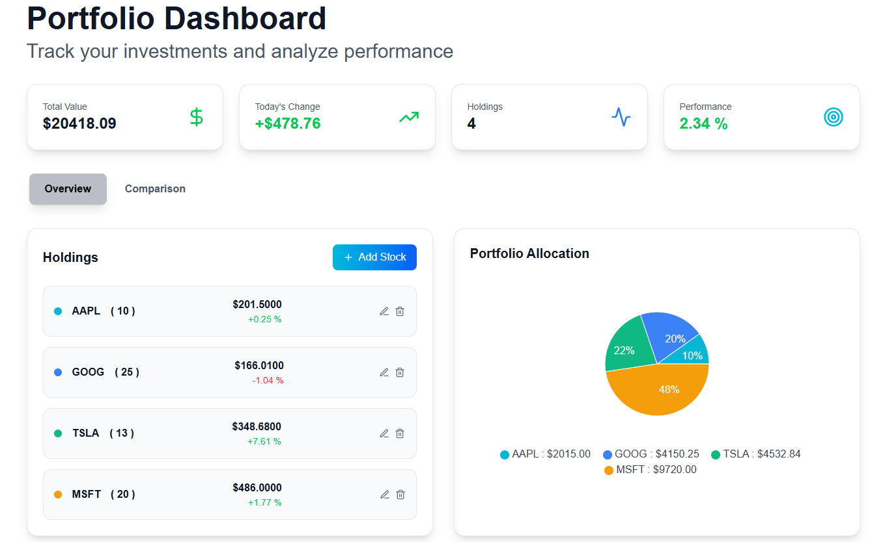
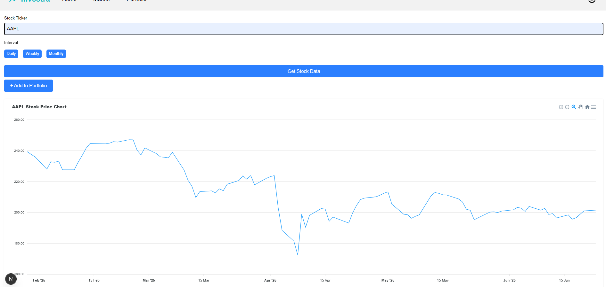
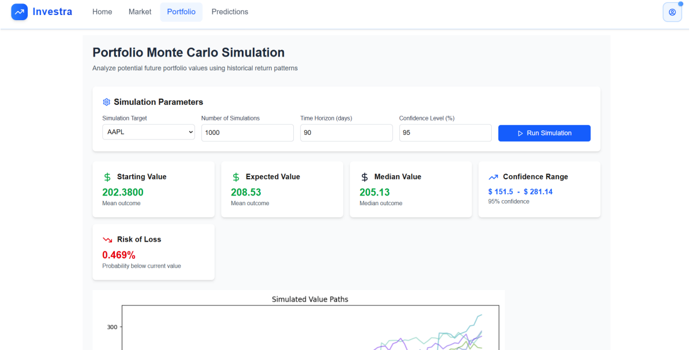
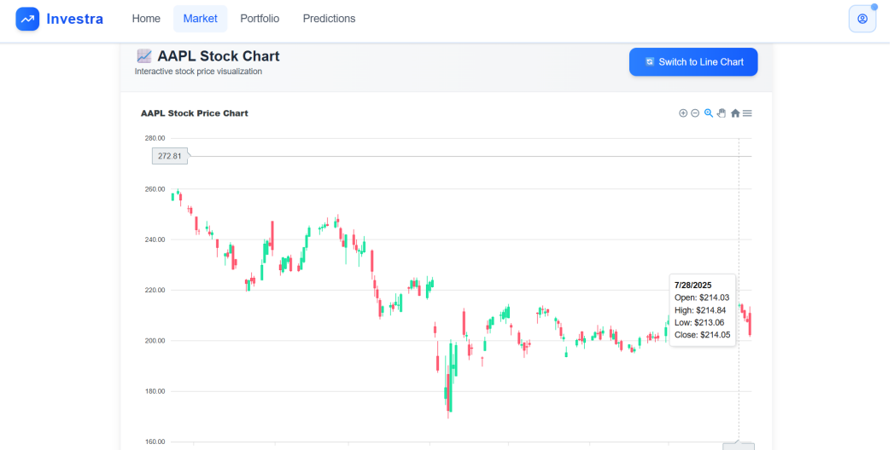

# Investra

Investra is a web-based application designed to analyze stock market behavior, risk assesment and investment portfolio handling. Built using Next.js, Flask, and PostgreSQL, and powered by real-time market data from Alpha Vantage, the platform combines modern web development with intelligent predictive models. It features a LSTM neural network, sentiment analysis and Monte Carlo simulations to predict and analyse the stock market.

---

